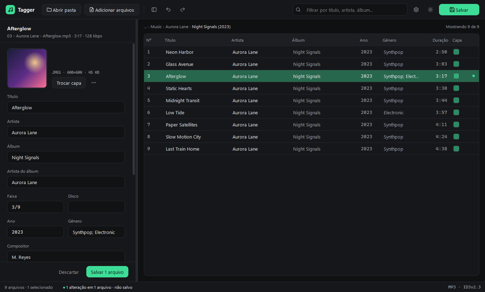

# Tagger

Tagger is a desktop app for editing and organizing the metadata of MP3 files. Open a folder, edit one file or hundreds at once, review your changes and save — nothing is written to disk until you click **Save**.



## Versions

- **v1.0:** Command-line interface (CLI) with the shared metadata backend for individual and bulk MP3 editing.
- **v2.0 (current):** Desktop application with a graphical interface built with **PySide6 (Qt)**, on the same backend.
- **v2.1 (planned):** FLAC/OGG/M4A support, automatic tag lookup (MusicBrainz + Cover Art Archive) and organizing files into `Artist/Album/` folders.
- **v3.0 (planned):** Cross-platform application (web and mobile) built with Flutter and Dart.

## Features

**Editing**
- Open a folder (optionally with subfolders), add files, or drag & drop them onto the window.
- Edit one file or many at once: fields that differ show as ‹various values› and only change if you type in them.
- Edit directly in the table (double-click or F2), with a search filter and configurable, reorderable columns.
- Fields: title, artist, album, album artist, track, disc, year, genre (with autocomplete), composer, lyricist, comment and **lyrics**.
- Number tracks in table order, and copy/paste tags between files.
- Values are validated as you type (year, track/disc numbers, genre).

**Safe by design**
- Every edit is a *pending change* (marked with a dot) until you save; discard any time.
- Undo/redo for saved changes and renames.
- If another program changed a file after Tagger read it, you are asked before anything is overwritten. **F5** reloads the list from disk.
- Each file is written in a single save (tags + cover together).
- Unexpected errors are logged and shown in a dialog instead of closing the app.

**Cover art**
- Drag an image, paste it, or choose a file. Large images are resized/converted to JPEG automatically (configurable).
- Only the front cover is replaced or removed — back covers and other embedded images are kept.
- Export the cover to a file, or save it as `cover.jpg` in the album folder.

**Organizing**
- **Rename files from tags** with a pattern such as `{tracknumber:02} - {artist} - {title}`, with a live preview, conflict detection and Windows-safe file names (undoable).
- **Fill tags from file names** with a pattern such as `%artist% - %title%`, including parent folders (`%artist%/%album%/%track% - %title%`).
- Real multi-value tags: `Artist A; Artist B` is saved as two values that modern players understand.
- Clean up extra tags: remove the old ID3v1 tag, unreadable frames, or everything Tagger doesn't show.

**Look & feel**
- Several dark and light themes, accent colors, fonts, font size and row density.
- Choice between ID3v2.3 (most compatible) and ID3v2.4.

## Installation and usage

### Windows executable

Download `Tagger.exe` from the [Releases](../../releases) page and run it — no Python needed. You can also drag MP3 files or folders onto the `.exe`.

### From source

Requires Python 3.12+ (developed and tested on 3.14).

```bash
git clone <repository-url>
cd Tagger
python -m venv .venv
.venv\Scripts\activate          # Windows  (source .venv/bin/activate on Linux/macOS)
pip install -r requirements.txt
python -m tagger
```

You can pass files or folders on the command line: `python -m tagger "D:\Music\Album"`.

### Command-line version

The original CLI is still available for quick edits in a terminal. It uses the same backend (same validation and the same tag format) and a native dialog to pick files:

```bash
python -m tagger.cli
```

## Keyboard shortcuts

| Shortcut | Action |
|---|---|
| `Ctrl+O` | Open folder |
| `Ctrl+S` | Save all pending changes |
| `Ctrl+Z` / `Ctrl+Y` | Undo / redo (`Ctrl+Z` with pending changes discards them) |
| `Esc` | Clear search, leave the editor, or cancel a pending undo |
| `F5` | Reload files from disk |
| `Ctrl+F` | Search |
| `Ctrl+E` | Show/hide the editor panel |
| `Ctrl+,` | Settings |
| `F2` | Edit the selected cell |
| `Ctrl+A` | Select all |
| `Delete` | Remove from the list (files are not deleted) |
| `Ctrl+Shift+N` | Number tracks in table order |
| `Ctrl+Shift+C` / `Ctrl+Shift+V` | Copy / paste tags |
| `Ctrl+Shift+R` | Rename files from tags |
| `Ctrl+Shift+T` | Fill tags from file names |

Right-click the table for all row actions, and right-click the column header to show/hide columns.

## Patterns

| Pattern | Example result |
|---|---|
| `{tracknumber:02} - {artist} - {title}` | `03 - Aurora Lane - Afterglow.mp3` |
| `{discnumber}-{tracknumber:02} {title}` | `1-03 Afterglow.mp3` |
| `%artist% - %title%` (reading) | `Aurora Lane - Afterglow.mp3` → artist, title |
| `%artist%/%album%/%track% - %title%` (reading) | uses the two parent folders too |

Both `{field}` and `%field%` work in either direction. Fields: `title`, `artist`, `album`, `albumartist`, `tracknumber` (`track`), `discnumber` (`disc`), `date` (`year`), `genre`, `composer`, `lyricist`, `comment`, `lyrics`. `{field:02}` pads numbers with zeros, and `{*}` skips text when reading names.

## Where things are stored

- **Settings:** Qt settings for "Tagger" (on Windows, the registry under `HKEY_CURRENT_USER\Software\Tagger\Tagger`).
- **Log:** `tagger.log` in the user data folder (on Windows, `%LOCALAPPDATA%\Tagger`).

## Development

```bash
pip install -r requirements-dev.txt
pytest                         # tests (backend, pending-changes logic and patterns; no GUI needed)
pyinstaller tagger.spec        # builds dist/Tagger.exe
```

The version lives only in `tagger/__init__.py`. Pushing a tag such as `v2.0.0` runs the tests, builds `Tagger.exe` and attaches it to a GitHub Release (`.github/workflows/release.yml`). See [CHANGELOG.md](CHANGELOG.md).

Project layout:

```
tagger/
  __main__.py     GUI entry point (python -m tagger)
  cli.py          command-line version (python -m tagger.cli)
  nucleo/         core logic, no Qt: tags (metadata.py), name patterns (padroes.py),
                  pending changes and saving (rascunho.py)
  gui/            main window (janela.py), editor panel, table, dialogs, themes
    recursos/     icon and optional fonts
tests/            pytest suite
docs/             screenshots
tagger.spec       PyInstaller build
```

## Technologies

- Python 3
- [PySide6](https://doc.qt.io/qtforpython/) (Qt 6) for the interface
- [Mutagen](https://mutagen.readthedocs.io/) for reading and writing ID3 tags
- Tkinter (CLI file picker only)

## License

MIT — see [LICENSE](LICENSE).
